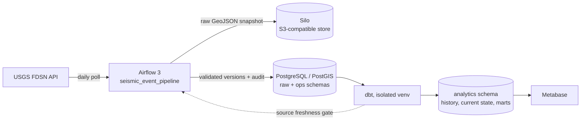

# SeismoWatch

Local reference platform for ingesting, versioning, and analysing USGS seismic-event data.

~~~text
USGS FDSN API -> Airflow -> S3-compatible raw snapshots -> PostgreSQL/PostGIS -> dbt -> Metabase
~~~

USGS can revise an event after its first publication. SeismoWatch keeps immutable source
snapshots and append-only observation versions, then exposes both historical and current-state
models — with the run audit, quarantine, watermark, and freshness SLO treated as first-class
data rather than logs.

## Architecture

## What it demonstrates

- Incremental polling on a `source_updated_at` watermark that keeps revisions of events
  outside the current logical date (ADR-002, with a regression test).
- Immutable raw GeoJSON snapshots, keyed per logical date so replays are idempotent.
- Contract validation with quarantine: rejected features are audited, never silently dropped,
  and never block valid rows.
- A run audit that survives failure: a crashed load is recorded as `failed`, not erased.
- Freshness as a gate: `dbt source freshness` fails the run when the landing zone goes stale.
- Idempotent ingestion keyed by `(event_id, source_updated_at)`.
- PostGIS geometry and H3 spatial indexing.
- dbt models for version history, current state, daily activity, regional risk, and ingestion
  reliability, guarded by schema and singular tests.
- An end-to-end workflow that boots the stack, replays a fixed historical window through the
  real DAG, and asserts on every layer.

## Run locally

Requirements: Docker and Docker Compose.

~~~bash
cp .env.example .env   # replace the change-me values before sharing the stack
docker compose up -d --build
~~~

Airflow standalone creates an `admin` user on first start. Print the generated password with:

~~~bash
docker compose exec airflow-standalone cat /opt/airflow/standalone_admin_password.txt
~~~

Services (published on loopback only):

| Service | Address |
| --- | --- |
| Airflow | http://localhost:8080 |
| Silo (S3) console | http://localhost:9001 |
| Metabase | http://localhost:3000 |
| PostgreSQL / PostGIS | localhost:5432 |

Trigger `seismic_event_pipeline` in Airflow, or replay a specific logical date:

~~~bash
make backfill BACKFILL_DS=2024-01-01
~~~

A successful run writes the raw snapshot, loads valid source versions, records rejected
features, advances the watermark, builds the dbt models, and gates on source freshness.

## Verifying

~~~bash
python3 -m pip install -r requirements-dev.txt   # host tooling, once
make test                                        # unit tests with coverage
make lint                                        # ruff over dags/tests/infra
make e2e                                         # full stack, historical window, asserted
~~~

The E2E run is deterministic: it replays a fixed historical date through the real DAG,
asserts on raw versions, run audit, quarantine consistency, marts, and idempotent replay —
and CI runs the same script.

## Data model

| Model | Purpose |
| --- | --- |
| `raw.seismic_event_observations` | Versioned source observations |
| `analytics.fct_seismic_event_versions` | Event revision history plus PostGIS geometry |
| `analytics.dim_seismic_event_current` | Latest known state for each event |
| `analytics.mart_daily_seismic_activity` | Daily counts and magnitude statistics |
| `analytics.mart_h3_regional_risk` | H3-cell activity and material-event metrics |
| `analytics.mart_ingestion_reliability` | Run outcomes, rejection rate, watermark age |
| `ops.ingestion_runs` | Per-attempt audit trail, including failures |
| `ops.rejected_events` | Quarantined features with rejection reasons |

## Operational rules

- An empty seismic day is a valid outcome: the poll exits clean and the models rebuild.
- A failed API poll or a non-advancing watermark is a freshness incident, enforced by
  `dbt source freshness` (warn 36h / error 72h) and visible in `mart_ingestion_reliability`.
- Invalid features are quarantined in `ops.rejected_events`; the counts are asserted against
  the run audit by a singular dbt test.
- Revisions are retained; consumers use the current-state model only when they do not need
  history.

## Documentation

- [Architecture](docs/architecture.md)
- [ADR-001: versioned source observations](docs/adr/001-versioned-source-observations.md)
- [ADR-002: logical-date snapshots and watermarks](docs/adr/002-logical-date-snapshots-and-watermarks.md)
- [USGS freshness runbook](docs/runbooks/usgs-source-freshness.md)
- [Changelog](CHANGELOG.md)

The dashboard query pack is in [metabase/seismic_dashboard.sql](metabase/seismic_dashboard.sql).
